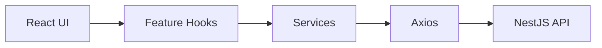

# Caverna Desktop

## Project Overview

Caverna Desktop is the React web client for Caverna Jiu-Jitsu, a platform for managing and following practitioners' journeys. The desktop now signs in against the NestJS API and exposes authenticated routes for academies, classes and the evaluation queue.

## Problem & Motivation

The client needs predictable boundaries for navigation, forms, remote data and UI state before feature work begins. This bootstrap makes those boundaries executable and testable without inventing backend behavior.

## Tech Stack

React, TypeScript, Vite, React Router, TanStack Query and Devtools (development only), Tailwind CSS, selected shadcn/ui-style components, Axios, Zod, React Hook Form, Zustand (reserved for a concrete global UI need), Sonner and Lucide React. Vitest, React Testing Library, ESLint, Prettier, Husky and lint-staged support quality checks. npm owns the lockfile.

## Architecture Overview



The diagram is the production flow. Pages call feature hooks, hooks coordinate TanStack Query, and feature services call the centralized Axios client. The session uses the backend bearer-token login contract and lives in memory only. The backend does not expose management contexts yet (#98), so login falls back to a clearly labeled local context to keep authenticated screens usable. Development-only preview routes remain available for visual QA and are never linked from the product. `app` composes features and shared resources; features depend on `shared`; `shared` depends on neither app nor features.

## Architectural Decisions

Feature ownership, query caching and fail-closed protected routes are recorded in [ADR 0001](docs/decisions/0001-feature-first-architecture.md). The neutral light/dark tokens are provisional until Caverna Figma tokens are agreed. The frontend never enforces backend authorization or duplicates domain rules.

## Project Structure

```text
src/
  app/                 providers, router and layouts
  features/            auth, management, academies, classes, evaluations, teachers, belts and certificates
  shared/              UI, HTTP, errors, notifications and query client
  styles/              provisional semantic tokens
  test/                test setup
docs/                 architecture and engineering guidance
specs/                template and illustrative authentication spec
```

Only directories containing actual files are present.

## Getting Started

Requires Node.js 20.19+ or 22.12+ and npm. Run:

```bash
npm ci
cp .env.example .env
npm run dev
```

Open the URL printed by Vite. `/` redirects to `/login`. After a successful sign-in the app opens `/academies`; the authenticated area also exposes `/classes` and `/evaluations`, sharing the management shell. `/management` lists authorized contexts when the backend provides them and otherwise shows the local fallback. `/access-denied` and `/session-expired` show safe informational states. `/preview/*` routes exist only during development for visual QA and are never linked from the product. The Vite dev server works without `.env` using documented local defaults.

## Environment Variables

| Variable              | Default                 | Purpose                      |
| --------------------- | ----------------------- | ---------------------------- |
| `VITE_API_BASE_URL`   | `http://localhost:3000` | Public NestJS API origin     |
| `VITE_API_TIMEOUT_MS` | `10000`                 | HTTP timeout in milliseconds |

Values are validated at startup. `VITE_*` values ship to the browser and must never contain secrets. `.env` and local overrides are ignored by Git.

## Available Scripts

| Script                                    | Purpose                               |
| ----------------------------------------- | ------------------------------------- |
| `npm run dev`                             | Start Vite development server         |
| `npm run build`                           | Typecheck and build production assets |
| `npm run preview`                         | Preview production assets             |
| `npm run lint` / `npm run lint:fix`       | Check or fix lint issues              |
| `npm run format` / `npm run format:check` | Apply or check Prettier               |
| `npm run typecheck`                       | Check strict TypeScript projects      |
| `npm test` / `npm run test:run`           | Watch or run tests once               |

## API Integration Strategy

Feature services own calls and runtime validation of external responses. Hooks pass AbortSignal, use domain query keys and invalidate after mutations. The central Axios client has a public base URL, configurable timeout and safe error normalization. Login unwraps the backend envelope `{ message, data, timestamp }` and validates the practitioner token payload. Management context endpoints remain pending on the backend. See [API integration](docs/api-integration.md).

## State Management Strategy

TanStack Query owns server state, freshness, retries and invalidation. React state handles local UI, and React Hook Form handles form state. Zustand is available only when a concrete cross-page UI state arises; no store is created for cached API data or toasts.

## Validation & Error Handling

Zod validates the login form, academy and unit forms, external API responses and environment. The HTTP boundary maps known failure categories into safe user-facing errors without exposing response bodies. Sonner notifications are centralized with consistent durations and stable IDs to avoid duplicates. Forms have labeled controls, inline errors and submission feedback. A failed management-context lookup does not block the authenticated screens; it activates the documented local fallback context.

## Testing & Code Quality

Vitest and React Testing Library cover component interaction, form validation, mocked HTTP behavior, session fallback, context selection, real-route navigation and error states. Run `npm run lint`, `npm run typecheck`, `npm run test:run`, `npm run format:check` and `npm run build` before review. Husky and lint-staged check changed files before commits. See [testing guidance](docs/testing.md).

## Spec-Driven Development Workflow

Use **Spec → Review → Implementation → Tests → Documentation → Pull Request**. The [spec template](specs/templates/feature-spec.md) captures the problem, requirements, contracts, UI states and acceptance tests. Keep small changes proportional. The [authentication example](specs/examples/authentication.md) lists open contract questions instead of making up endpoints.

## Development Conventions

Use `@/` imports, keep HTTP out of components, make features own their UI and hooks, and add shared abstractions only when they provide real reuse. Maintain semantic HTML, keyboard behavior and responsive layouts. See [conventions](docs/conventions.md) and [architecture](docs/architecture.md).

### Agent Skills

[`AGENTS.md`](AGENTS.md) routes agent work to three Agent Skills in `.agents/skills/`:

| Skill                                                      | Use it for                                                                    | Example request                                       |
| ---------------------------------------------------------- | ----------------------------------------------------------------------------- | ----------------------------------------------------- |
| [`trello-task`](.agents/skills/trello-task/SKILL.md)       | Read a card, preserve its acceptance criteria and create a traceable SDD spec | “Read the login card and explain the implementation.” |
| [`create-feature`](.agents/skills/create-feature/SKILL.md) | Implement a reviewed feature with tests and quality gates                     | “Implement the academy list from its spec.”           |
| [`create-pr`](.agents/skills/create-pr/SKILL.md)           | Review, validate, commit and open a PR to `main`                              | “Create a PR for this feature.”                       |

For a card-to-PR request, use them in that order. Each skill has entry/exit criteria, operational steps, references and a reusable output template. The Trello skill uses the environment's connector and stores no credentials. GitHub publication respects branch protection. See [skill validation and dry runs](docs/agent-skills.md).

## Roadmap

1. Receive authorized management contexts from the backend (#98) and replace the temporary local context.
2. Enforce per-operation authorization on the management API so the desktop screens stop relying on unguarded endpoints.
3. Decide session renewal/persistence and logout behavior with the backend.
4. Finish the detailed Figma review when the design connector is available; replace the current visual approximation with approved tokens and components.
5. Build the remaining management areas (students, teachers, units) on top of the real routes.

## Contributing

Start meaningful work with a proportionate spec, review the API and design dependencies, implement with tests, run the quality scripts and open a focused pull request using Conventional Commits. Do not commit credentials or introduce client-side authorization as a substitute for API checks.
